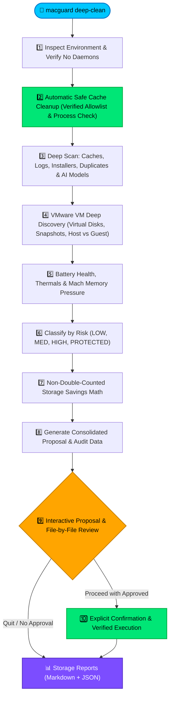

<div align="center">

# 🛡️ MacGuard
### On-Demand Maintenance, Deep Storage Analysis & Performance Engine for macOS

[](https://apple.com)
[](https://python.org)
[](https://github.com/AtiaAbk/mac-guard-autometic-storage-optimizer)
[](https://github.com/AtiaAbk/mac-guard-autometic-storage-optimizer)
[](LICENSE)

<br/>

> **Purely User-Triggered. Zero Background Daemons. Explicit Granular Approvals.**  
> MacGuard inspects your storage, hardware health, and virtual machines in read-only mode, cleans verified allowlist caches safely, presents a unified proposal, and executes **only what you explicitly confirm**.

</div>

---

## ⚡ The MacGuard Philosophy

Traditional Mac "cleaner" tools run intrusive background daemons, install persistent startup agents, and quietly delete files behind your back.

**MacGuard works differently:**
- 🚫 **No Background Schedulers:** No launchd daemons, startup services, or cron jobs. MacGuard runs **only** when you invoke `macguard deep-clean` (or alias `macguard mission`).
- 🧹 **Automatic Safe Cache Cleanup:** Automatically cleans only a predefined allowlist of verified disposable/regenerable caches. Verifies no dependent application is actively running before touching any cache.
- 🔍 **Complete Read-Only Inspection First:** Evaluates SSD caches, logs, duplicate files, installers, VMware VMs, and battery health before proposing any action.
- 🎯 **No Repetitive File Prompts:** Groups files into clean risk-based action categories with exact apparent and allocated disk sizes.
- 📂 **Granular File-by-File Review:** Inspect and select individual installer images (`.dmg`/`.pkg`/`.iso`/`.zip`) and duplicate clusters before approving.
- ✋ **Explicit Per-Group Confirmation:** Never deletes an approved group without affirmative confirmation (`yes`/`y`). Pressing Enter or empty input **never** approves deletion.
- 🧮 **Non-Double-Counted Math:** Eliminates nested directory overlap and computes duplicate savings as $(N-1) \times \text{size}$.
- 🔒 **Zero-Credential Security:** Never asks for or stores passwords. System paths (`/System`, `/usr`), source code, personal documents, and VM disks are strictly shielded.

---

## 🔄 10-Stage Mission Pipeline

When you run `macguard deep-clean`, the engine executes 10 stages in sequence:



---

## 🖥️ Live Terminal Interface Preview

MacGuard provides a live terminal interface with graphical storage meters, category badges, and prompt confirmation guards:

```text
════════════════════════════════════════════════════════════════════════════════
                     MACGUARD ON-DEMAND MAINTENANCE ENGINE                    
             Exclusively User-Triggered | Zero Background Services            
════════════════════════════════════════════════════════════════════════════════

[1/10] Inspecting Environment & Verifying On-Demand Configuration
  • Host:     macOS 26.6.2 (Apple M4, 10 cores, 16.0 GB RAM)
  • Storage:  [█████████████████░░░░░░░] 68.8% | Free: 143.5 GB of 460.4 GB
  • Security: SIP System Integrity Protection enabled.
  ✓ Verification: Purely on-demand. Zero background daemons or launchd jobs.

[2/10] Automatic Safe Cache Cleanup (Predefined Allowlist & Process Verification)
  ✓ Automatically Cleaned: Apple Help Viewer Disposable Cache (20.51 KB)
  • Skipped 'Google Chrome Web Cache': Process 'Google Chrome' is actively running.

[3/10] Analyzing Storage: Caches, Logs, Installers, Duplicates & Developer Artifacts
  • Application Caches:     8 targets (3.17 GB)
  • Diagnostic Logs:        12 items (45.2 MB)
  • Downloaded Installers:  3 files (1.80 GB)
  • Duplicate Candidates:   2 clusters (450.0 MB)
  • Developer Artifacts:    Xcode DerivedData (2.10 GB), Pip Cache (120 MB)

[4/10] Discovering VMware Virtual Machines & Inspecting Host Storage
  • Discovered 2 VM bundle(s) (45.0 GB):
    - Ubuntu 24.04 (ubuntu64): 25.0 GB, 1 snapshot [STRICTLY PROTECTED - NO CHANGES]
    - Windows 11 (windows11-64): 20.0 GB, 0 snapshots [STRICTLY PROTECTED - NO CHANGES]

[5/10] Assessing Battery Health, Thermal State & System Pressure
  • Battery:   92% (charging) on AC Power | Condition: Normal (242 cycles)
  • CPU Load:  [2.11, 2.30, 2.43] | Memory Pressure: Normal

[6/10] Classifying Findings by Risk, Usefulness, Confidence & Action
  ✓ Structured discovered items into 5 distinct proposal categories.

[7/10] Calculating Realistic Non-Double-Counted Potential Storage Savings
  • Net Realistic Potential:  7.68 GB
  • Recommended Safe Savings: 5.27 GB (Low-Risk disposable caches only)

──── [ CONSOLIDATED ACTION PROPOSAL ] ──────────────────────────────────────────
#    STATUS       RISK       ITEMS    RECOVERABLE   CATEGORY
────────────────────────────────────────────────────────────────────────────────
[1 ] [APPROVED]   LOW        40837    3.17 GB       Verified Disposable Application Caches
[2 ] [APPROVED]   LOW        699      2.10 GB       Developer Build Artifacts & Package Caches
[3 ] [REJECTED]   MEDIUM     12       45.20 MB      Old Application and Diagnostic Logs
[4 ] [CUSTOM 1/3] MEDIUM     1        781.25 KB     Downloaded Disk Images & Installers (.dmg / .pkg)
[5 ] [CUSTOM 1/2] HIGH       1        250.00 MB     Identical Duplicate File Candidates
[6 ] [PROTECTED]  PROTECTED  2        45.00 GB      VMware Virtual Machines (Ubuntu / Windows)
────────────────────────────────────────────────────────────────────────────────

Review & Approval Commands:
  • 'approve <#>'             -> Approve entire group (e.g. 'approve 1,2')
  • 'approve low-risk'        -> Approve all low-risk disposable cache groups
  • 'review installers'       -> Inspect and select specific .dmg / .pkg installers
  • 'review duplicates'       -> Inspect and select specific duplicate copies
  • 'proceed'                 -> Proceed to explicit confirmation before execution
  • 'quit'                    -> Exit safely with zero modifications
```

---

## 📖 Step-by-Step Operating Guide

MacGuard is designed to be interactive, transparent, and completely under your control. Here is how to operate it from start to finish:

### Step 1: Launch MacGuard
Open Terminal and run:
```bash
macguard deep-clean
```
*(Or double-click `Launch_MacGuard.command` in Finder).*

### Step 2: Automatic Safe Cache Cleanup (Zero Risk)
MacGuard first inspects your system and cleans **only** a verified allowlist of regenerable, disposable user caches (e.g., Apple Help Viewer caches, font caches, QuickLook thumbnails, package manager caches).
- **Process Liveness Protection:** Before touching any cache, MacGuard checks if the corresponding application is running (e.g., Google Chrome, Safari, Slack). If the app is active, its cache is automatically skipped.
- Reclaimed space is measured and reported right away.

### Step 3: Understand the Consolidated Action Proposal
After analyzing your storage, MacGuard displays an interactive menu grouping findings into risk tiers:
- **`[APPROVED]` (Green):** Low-risk disposable caches and build artifacts pre-selected for your convenience.
- **`[REJECTED]` (Gray):** Medium and High-risk items (logs, installers, duplicates) that are unselected by default.
- **`[CUSTOM X/Y]` (Cyan):** Indicates individual files you have reviewed and selected.
- **`[PROTECTED]` (Blue):** Inviolable items (e.g., VMware virtual machines, system files) that MacGuard inspects for your information but will **never** modify.

### Step 4: Interact with the Proposal Menu
Type any of the following commands directly at the prompt:

| Command | Action |
| :--- | :--- |
| `approve <#>` | Approve a specific category by number (e.g., `approve 1` or `approve 1,2`). |
| `approve low-risk` | Approve all low-risk disposable cache groups at once. |
| `reject <#>` | Uncheck a group so its files remain untouched (e.g., `reject 1`). |
| `details <#>` | Inspect the list of exact file paths contained in group `#`. |
| `review installers` | Open the interactive file-by-file installer selector. |
| `review duplicates` | Open the duplicate cluster resolver to choose which copies to delete. |
| `proceed` | Move to explicit per-group confirmation and execution. |
| `quit` | Exit immediately. Zero optional files are modified. |

> [!NOTE]
> **Safety Rule on Input:** Pressing **Enter with empty input** or typing an invalid command will **never** approve any action.

---

### Step 5: File-by-File Review (Installers & Duplicates)

#### A. Reviewing Old Installers (`review installers` or `review 4`)
Displays every discovered `.dmg`, `.pkg`, `.iso`, and `.zip` installer with its path, size, and date:
```text
[1] /Users/.../Downloads/Docker.dmg (780.20 MB) - Modified: 2026-08-10
[2] /Users/.../Downloads/Postman.zip (145.10 MB) - Modified: 2026-09-02

Commands:
  • 'delete 1'    -> Mark Docker.dmg for deletion
  • 'keep 1'      -> Keep Docker.dmg (do not delete)
  • 'delete all'  -> Mark all listed installers
  • 'keep all'    -> Unmark all listed installers
  • 'done'        -> Save your selection and return to main proposal
```

#### B. Reviewing Duplicate Clusters (`review duplicates` or `review 5`)
MacGuard matches identical files by cryptographic SHA-256 hash. The first copy is always identified as the original:
```text
[Cluster #1] Matching SHA256 (2 identical copies, 450 MB each):
  (1) [KEEP ORIGINAL]     /Users/.../Documents/presentation_final.mp4
  (2) [DELETE CANDIDATE] /Users/.../Downloads/presentation_final_copy.mp4

Commands:
  • 'default'         -> Automatically keep copy 1 and mark copies 2..N for deletion
  • 'delete 1.2'      -> Mark cluster 1, copy 2 for deletion
  • 'keep 1.2'        -> Keep cluster 1, copy 2
  • 'keep all'        -> Unmark all duplicate candidates
  • 'done'            -> Save selection and return to main proposal
```

---

### Step 6: Explicit Affirmative Confirmation
When you type `proceed`, MacGuard asks for confirmation **individually for each approved group**.
It displays:
- The category name and risk level
- Total files to be removed
- Estimated recoverable space
- The full list of target paths

```text
================================================================================
  EXPLICIT CONFIRMATION: Downloaded Installers & Disk Images [old_installers]
================================================================================
Scope of Proposed Operations:
  • Risk Level:        MEDIUM
  • Files to Remove:   1 target item(s)
  • Estimated Space:   780.20 MB
Target Paths:
    [1] /Users/.../Downloads/Docker.dmg (780.20 MB)
--------------------------------------------------------------------------------
Type 'yes' or 'y' to confirm deletion of this group [y/N]:
```

- Type **`yes`** or **`y`** to execute the deletion of this specific group.
- **Pressing Enter, typing `n`, timeout, or pressing `Ctrl+C` will skip the group safely.**

---

### Step 7: Post-Verification & Reports
After execution, MacGuard:
1. Re-queries disk storage via `statvfs` to verify actual byte-level disk recovery.
2. Generates two timestamped audit reports in `~/.macguard/reports/`:
   - 📄 **Markdown (`.md`):** Human-readable summary with storage breakdowns, hardware state, and skipped items.
   - 🤖 **JSON (`.json`):** Full machine-readable record for automated audits.
3. You can inspect the latest report at any time with:
   ```bash
   macguard reports latest
   ```

---

## 🛡️ Safety & Privilege Policies

| Resource | Classification | MacGuard Action |
| :--- | :---: | :--- |
| **System Paths (`/System`, `/usr`, `/bin`)** | `PROTECTED` | 🚫 Hard block. Never modified under any circumstance. |
| **Virtual Machines (`.vmwarevm`, `.vmdk`, `.vmem`)** | `PROTECTED` | 🚫 Hard block. Host storage inspected; files kept 100% intact. |
| **Source Code & Documents (`.py`, `.git`, `.docx`)** | `PROTECTED` | 🚫 Hard block. Personal files and repositories shielded. |
| **Old Installers (`.dmg`, `.pkg`, `.iso`)** | `MEDIUM` | ⚠️ Review required. File-by-file selection supported. |
| **Duplicate Files (SHA256 Match)** | `HIGH` | ⚠️ Review required. Must keep at least 1 original copy. |
| **Disposable App Caches (`~/Library/Caches`)** | `LOW` | ✅ Safe cleanup. Regenerated automatically by macOS/apps. |
| **Developer Artifacts (DerivedData, pip)** | `LOW` | ✅ Safe cleanup. Rebuildable build caches. |

> [!IMPORTANT]
> **No Password Prompting Policy:**  
> MacGuard never prompts for passwords via custom scripts and never stores credentials. If a file requires elevated permissions, MacGuard explains the exact operation, provides the manual `sudo` command, and skips the file safely.

---

## 🚀 Quick Start

### 1. One-Click Setup
Choose your preferred way to install and configure your `$PATH`:

- **Option A (Finder Double-Click):** Just double-click **`install.command`** in Finder!
- **Option B (Terminal):** Run `./install.sh` from the repository folder:
  ```bash
  ./install.sh
  ```

*The installer automatically links `macguard` to your binary paths and registers the global command in `~/.zshrc` and `~/.bash_profile`.*

### 2. Start Your Mission
Anywhere in your terminal, simply run:
```bash
macguard deep-clean
```
*(Or alias `macguard mission`, or double-click **`Launch_MacGuard.command`** in Finder to run with one click!)*

### 3. CLI Command Options

| Command | Description |
| :--- | :--- |
| `macguard deep-clean` | Launch the full 10-stage deep storage analysis and safe cache cleanup engine. |
| `macguard mission` | Alias for `macguard deep-clean`. |
| `macguard deep-clean --dry-run` | Run all scans and simulate approved executions without modifying any file. |
| `macguard deep-clean --synthetic-test` | Run self-contained test on temporary synthetic files. |
| `macguard deep-clean --approve-low-risk` | Automatically select low-risk disposable caches in review menu. |
| `macguard deep-clean --reject-all` | Run scan, generate reports, and exit without any optional modifications. |
| `macguard status` | Display engine configuration, on-demand status, and report count. |
| `macguard reports list` | List all saved JSON and Markdown mission reports. |
| `macguard reports latest` | Print the latest mission report in terminal. |

---

## 📊 Reports & Verifiable Audit Trail

Every mission writes persistent audit artifacts under `~/.macguard/`:
- 📄 **Human-Readable Report:** `~/.macguard/reports/macguard_mission_YYYYMMDD_HHMMSS.md`
- 🤖 **Machine-Readable JSON:** `~/.macguard/reports/macguard_mission_YYYYMMDD_HHMMSS.json`
- 📜 **Append-Only Audit Log:** `~/.macguard/audit/audit.log`

---

## 🧪 Automated Test Suite

MacGuard includes unit and integration tests covering the safety policy, double-counting math, concurrency locking, and end-to-end interactive workflows:

```bash
PYTHONPATH=src python3 -m unittest discover -s tests -p "test_*.py"
```

---

<div align="center">

Built with ❤️ for macOS users who value control, transparency, and safety.  
**MacGuard: You command, it inspects, you approve, it executes.**

</div>
