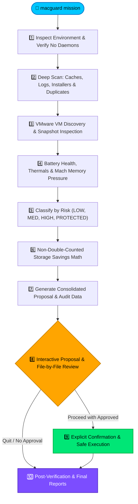

<div align="center">

# 🛡️ MacGuard
### On-Demand Maintenance, Deep Storage Analysis & Performance Engine for macOS

[](https://apple.com)
[](https://python.org)
[](https://github.com/AtiaAbk/mac-guard-autometic-storage-optimizer)
[](https://github.com/AtiaAbk/mac-guard-autometic-storage-optimizer)
[](LICENSE)

<br/>

> **Purely User-Triggered. Zero Background Daemons. Explicit Granular Approvals.**  
> MacGuard inspects your storage, hardware health, and virtual machines in read-only mode, presents a unified proposal, and executes **only what you explicitly confirm**.

</div>

---

## ⚡ The MacGuard Philosophy

Traditional Mac "cleaner" tools run intrusive background daemons, install persistent startup agents, and quietly delete files behind your back.

**MacGuard works differently:**
- 🚫 **No Background Schedulers:** No launchd daemons, startup services, or cron jobs. MacGuard runs **only** when you invoke `macguard mission`.
- 🔍 **Complete Read-Only Inspection First:** Evaluates SSD caches, logs, duplicate files, installers, VMware VMs, and battery health before proposing any action.
- 🎯 **No Repetitive File Prompts:** Groups files into clean risk-based action categories with exact sizes and recoverable space.
- 📂 **Granular File-by-File Review:** Inspect and select individual installer images (`.dmg`/`.pkg`) and duplicate clusters before approving.
- ✋ **Explicit Per-Group Confirmation:** Never deletes an approved group without affirmative confirmation (`yes`/`y`). Pressing Enter or empty input **never** approves deletion.
- 🧮 **Non-Double-Counted Math:** Eliminates nested directory overlap and computes duplicate savings as $(N-1) \times \text{size}$.
- 🔒 **Zero-Credential Security:** Never asks for or stores passwords. System paths (`/System`, `/usr`), source code, personal documents, and VM disks are strictly shielded.

---

## 🔄 10-Stage Mission Pipeline

When you run `macguard mission`, the engine executes 10 stages in sequence:



---

## 🖥️ Live Terminal Interface Preview

MacGuard provides a live terminal interface with graphical storage meters, category badges, and prompt confirmation guards:

```text
════════════════════════════════════════════════════════════════════════════════
                     MACGUARD ON-DEMAND MAINTENANCE ENGINE                    
             Exclusively User-Triggered | Zero Background Services            
════════════════════════════════════════════════════════════════════════════════

[1/10] Inspecting Environment & Verifying On-Demand Configuration
  • Host:     macOS 26.6.2 (Apple M4, 10 cores, 16.0 GB RAM)
  • Storage:  [█████████████████░░░░░░░] 68.8% | Free: 143.5 GB of 460.4 GB
  • Security: SIP System Integrity Protection enabled.
  ✓ Verification: Purely on-demand. Zero background daemons or launchd jobs.

[2/10] Analyzing Storage: Caches, Logs, Installers, Duplicates & Developer Artifacts
  • Application Caches:     8 targets (3.17 GB)
  • Diagnostic Logs:        12 items (45.2 MB)
  • Downloaded Installers:  3 files (1.80 GB)
  • Duplicate Candidates:   2 clusters (450.0 MB)
  • Developer Artifacts:    Xcode DerivedData (2.10 GB), Pip Cache (120 MB)

[3/10] Discovering VMware Virtual Machines & Inspecting Host Storage
  • Discovered 2 VM bundle(s) (45.0 GB):
    - Ubuntu 24.04 (ubuntu64): 25.0 GB, 1 snapshot [STRICTLY PROTECTED - NO CHANGES]
    - Windows 11 (windows11-64): 20.0 GB, 0 snapshots [STRICTLY PROTECTED - NO CHANGES]

[4/10] Assessing Battery Health, Thermal State & System Pressure
  • Battery:   92% (charging) on AC Power | Condition: Normal (242 cycles)
  • CPU Load:  [2.11, 2.30, 2.43] | Memory Pressure: Normal

[5/10] Classifying Findings by Risk, Usefulness, Confidence & Action
  ✓ Structured discovered items into 5 distinct proposal categories.

[6/10] Calculating Realistic Non-Double-Counted Potential Storage Savings
  • Net Realistic Potential:  7.68 GB
  • Recommended Safe Savings: 5.27 GB (Low-Risk disposable caches only)

──── [ CONSOLIDATED ACTION PROPOSAL ] ──────────────────────────────────────────
#    STATUS       RISK       ITEMS    RECOVERABLE   CATEGORY
────────────────────────────────────────────────────────────────────────────────
[1 ] [APPROVED]   LOW        40837    3.17 GB       Verified Disposable Application Caches
[2 ] [APPROVED]   LOW        699      2.10 GB       Developer Build Artifacts & Package Caches
[3 ] [REJECTED]   MEDIUM     12       45.20 MB      Old Application and Diagnostic Logs
[4 ] [CUSTOM 1/3] MEDIUM     1        781.25 KB     Downloaded Disk Images & Installers (.dmg / .pkg)
[5 ] [CUSTOM 1/2] HIGH       1        250.00 MB     Identical Duplicate File Candidates
[6 ] [PROTECTED]  PROTECTED  2        45.00 GB      VMware Virtual Machines (Ubuntu / Windows)
────────────────────────────────────────────────────────────────────────────────

Review & Approval Commands:
  • 'approve <#>'             -> Approve entire group (e.g. 'approve 1,2')
  • 'approve low-risk'        -> Approve all low-risk disposable cache groups
  • 'review installers'       -> Inspect and select specific .dmg / .pkg installers
  • 'review duplicates'       -> Inspect and select specific duplicate copies
  • 'proceed'                 -> Proceed to explicit confirmation before execution
  • 'quit'                    -> Exit safely with zero modifications
```

---

## 🛡️ Safety & Privilege Policies

| Resource | Classification | MacGuard Action |
| :--- | :---: | :--- |
| **System Paths (`/System`, `/usr`, `/bin`)** | `PROTECTED` | 🚫 Hard block. Never modified under any circumstance. |
| **Virtual Machines (`.vmwarevm`, `.vmdk`, `.vmem`)** | `PROTECTED` | 🚫 Hard block. Host storage inspected; files kept 100% intact. |
| **Source Code & Documents (`.py`, `.git`, `.docx`)** | `PROTECTED` | 🚫 Hard block. Personal files and repositories shielded. |
| **Old Installers (`.dmg`, `.pkg`, `.iso`)** | `MEDIUM` | ⚠️ Review required. File-by-file selection supported. |
| **Duplicate Files (SHA256 Match)** | `HIGH` | ⚠️ Review required. Must keep at least 1 original copy. |
| **Disposable App Caches (`~/Library/Caches`)** | `LOW` | ✅ Safe cleanup. Regenerated automatically by macOS/apps. |
| **Developer Artifacts (DerivedData, pip)** | `LOW` | ✅ Safe cleanup. Rebuildable build caches. |

> [!IMPORTANT]
> **No Password Prompting Policy:**  
> MacGuard never prompts for passwords via custom scripts and never stores credentials. If a file requires elevated permissions, MacGuard explains the exact operation, provides the manual `sudo` command, and skips the file safely.

---

## 🚀 Quick Start

### 1. Installation
Clone the repository and install the `macguard` command into your `PATH`:

```bash
git clone https://github.com/AtiaAbk/mac-guard-autometic-storage-optimizer.git
cd mac-guard-autometic-storage-optimizer
./install.sh
```

### 2. Run an Interactive Maintenance Mission
```bash
macguard mission
```

### 3. CLI Command Options

| Command | Description |
| :--- | :--- |
| `macguard mission` | Launch the full 10-stage interactive maintenance engine. |
| `macguard mission --dry-run` | Run all scans and simulate approved executions without modifying any file. |
| `macguard mission --synthetic-test` | Run self-contained test on temporary synthetic files. |
| `macguard mission --approve-low-risk` | Automatically select low-risk disposable caches. |
| `macguard mission --reject-all` | Run scan, generate reports, and exit without changes. |
| `macguard status` | Display engine configuration, on-demand status, and report count. |
| `macguard reports list` | List all saved JSON and Markdown mission reports. |
| `macguard reports latest` | Print the latest mission report in terminal. |

---

## 📊 Reports & Verifiable Audit Trail

Every mission writes persistent audit artifacts under `~/.macguard/`:
- 📄 **Human-Readable Report:** `~/.macguard/reports/macguard_mission_YYYYMMDD_HHMMSS.md`
- 🤖 **Machine-Readable JSON:** `~/.macguard/reports/macguard_mission_YYYYMMDD_HHMMSS.json`
- 📜 **Append-Only Audit Log:** `~/.macguard/audit/audit.log`

---

## 🧪 Automated Test Suite

MacGuard includes unit and integration tests covering the safety policy, double-counting math, concurrency locking, and end-to-end interactive workflows:

```bash
PYTHONPATH=src python3 -m unittest discover -s tests -p "test_*.py"
```

---

<div align="center">

Built with ❤️ for macOS users who value control, transparency, and safety.  
**MacGuard: You command, it inspects, you approve, it executes.**

</div>
